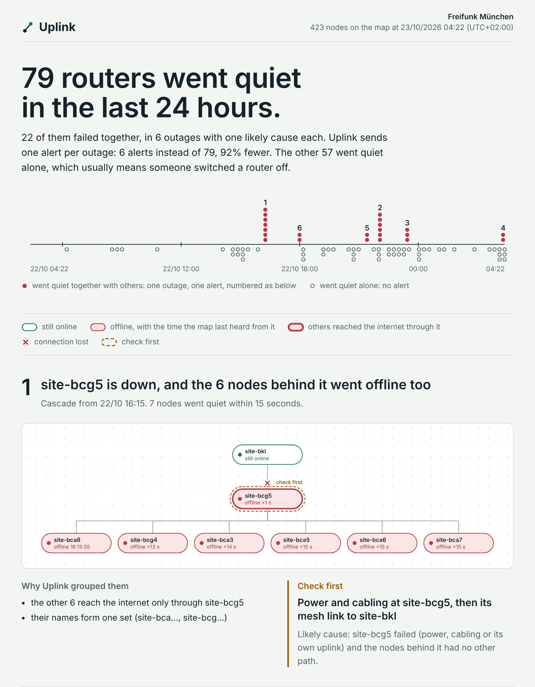

# Uplink

**When a community Wi-Fi network breaks, Uplink tells the volunteers what broke, why, and what to check first, on their phone, in English, Telugu or Hindi.**

Freifunk München runs about 2,090 routers, with over 3,000 people online on a weekday night, all looked after by volunteers. Its public map turns failed routers red, but never says why. In the 24 hours before 23 October 2026, 79 routers went quiet. Reading the same public data, Uplink found 6 real outages among them. The biggest was one rooftop antenna that took the six antennas behind it offline within 15 seconds.

- **6 alerts instead of 79** (92% less noise). Lone routers that someone switched off don't trigger alerts.
- **About 7 minutes earlier than the map**, which waits about 10 minutes before marking a router offline.
- **Every alert says what to check first**, written by **Muse Spark** in the volunteer's language.
- **Volunteers can ask by voice** in Telugu, Hindi or English, transcribed by **Muse Voice Transcribe**.

Try it in 30 seconds, with no keys and nothing to install (Python 3.10+):

    python -m uplink analyze --file tests/fixtures/munich-2026-10-23.json

<picture>
  <source media="(prefers-color-scheme: dark)" srcset="docs/outage-page-dark.png">
  
</picture>

`analyze --html outages.html` draws this page for any saved snapshot, or for the live map without `--file`.

```
$ python3 -m uplink analyze --file tests/fixtures/munich-2026-10-23.json

In the last 24 h, 79 nodes went quiet: 6 outages involving several nodes, and 57 single nodes.

1. 22/10 16:15  [cascade] site-bcg5 is down, and the 6 nodes behind it went offline too, all within 15 s
     · the other 6 reach the internet only through site-bcg5
     · their names form one set (site-bca…, site-bcg…)
     check first: power and cabling at site-bcg5, then its mesh link to site-bkl

2. 22/10 22:03  [site] 6 nodes at one location went offline together, all within 7 s
     · their names form one set (site-bfa…)
     · they used 3 different gateways, so the gateways are not the problem
     check first: power and the internet line at that location

3. 22/10 23:26  [site] 3 nodes at one location went offline together, all within 8 s
     · their names form one set (site-bfa…)
     · they last booted within the same minute (22/10 11:12), so they likely share a power supply
     ...
```

That is real data from the Munich map (router names replaced, contact details removed). The same
cascade, as it arrives on a volunteer's phone:

```
*site-bcg5 ఆఫ్‌లైన్ అయింది, దాని వెనుక ఉన్న 6 నోడ్‌లు కూడా ఆఫ్‌లైన్ అయ్యాయి*
22/10 16:15 నుండి · Freifunk München · ఆఫ్‌లైన్ నోడ్‌లు: 7
కారణం కావచ్చు: site-bcg5 వద్ద విద్యుత్ లేదా అప్‌లింక్ సమస్య
ముందుగా చూడండి: site-bcg5 వద్ద విద్యుత్ సరఫరా, కేబుల్స్
```

Volunteers can also ask, by text or voice note: "what is down right now?", "is Daniel5 up?".

## Why it matters beyond Munich

Most last-mile Wi-Fi has no operations team. India alone has over 4 lakh PM-WANI public Wi-Fi hotspots, run by local entrepreneurs through 207 aggregators. In April 2026 India's telecom regulator (TRAI) proposed outside help with network management to reduce the burden on these small operators. Uplink is built for that reader: someone who needs to hear "the router behind the tea stall lost power", in their own language, on the phone they already use. Today it works with any Freifunk map that publishes meshviewer.json. PM-WANI aggregators are the next step.

**Delivery.** Uplink supports the WhatsApp Cloud API (built and tested) and Telegram. Meta's review of new business accounts locked our WhatsApp account during the hackathon, so the live demo runs on Telegram. Switching back is one setting (`MESSENGER`).

## How it works

```
map.ffmuc.net ──▶ watch ──▶ correlate ──▶ incidents ──▶ Muse Spark ──▶ check ──▶ WhatsApp
  every 60 s      silent      5 kinds of    confirm,       writes in      no invented
                  nodes       evidence      routine,       your language  numbers
                  after 3 min               rate limit
voice note ──▶ webhook ──▶ ffmpeg ──▶ Muse Voice Transcribe ──▶ Muse Spark ──▶ reply
```

**Watch.** Uplink polls the map's `meshviewer.json` once a minute, politely (conditional requests,
gzip, a User-Agent with your contact). The map keeps a silent router "online" for about ten
minutes; Uplink counts a node as down once it has been silent for three, so it usually knows
several minutes before the map does.

**Correlate.** A lone router going dark is usually someone unplugging it. Several going dark
together usually share a cause, and the public data says which. Uplink links failed nodes by
evidence, and every piece of evidence also requires the failures to line up in time:

| Evidence | Meaning | Usually points to |
|---|---|---|
| behind | it reached the internet through a node that failed first | that node: power, cabling, its uplink |
| shared uplink | both reached the internet through a neighbour that stayed up | the links into that neighbour |
| mesh link | they were wired or radio-linked to each other | one location |
| co-booted | they last booted within the same minute | a shared power supply |
| name family | the operator named them as a set (`St.Georg3`, `St.Georg5`) | one operator, one site |

Linked failures become one outage: a **cascade** (one root, everything else behind it), a
**shared neighbour** failure, a **site** outage (power or internet at one place), a **gateway**
outage, or a **single** node.

**Decide.** Outages become incidents that grow as late failures arrive, merge when new evidence
links them, and resolve when the root is back (stragglers get five minutes). An incident alerts
when it is still there one poll later and involves several nodes, a gateway, enough people, or a
node you watch. A node that fails at the same time on several days (a café's router on a timer)
is routine and stays quiet. A quarter of the map vanishing at once is treated as a monitoring
problem, not 500 outages.

**Write.** Muse Spark (`muse-spark-1.3`) receives a fact sheet the code has already settled and
writes the message in the reader's language. The draft is checked before it is sent: any number
that is not in the facts, any link, or an overlong text gets one rewrite request, then the
hand-written template goes out instead. An alert always arrives, and it is always right.

**Listen.** Voice notes (OGG/Opus, from WhatsApp or Telegram) are converted with ffmpeg to 16 kHz mono WAV, transcribed
by Muse Voice Transcribe with a Telugu/English/Hindi bias, and answered from Uplink's live state.

**Talk back.** Reply to any alert: "why?", "what do I check first?", "say it in Hindi", or a voice note. Muse Spark answers from that alert's own evidence, in your language, and the same number check applies.

## Quick start

Needs Python 3.10 or newer, nothing else. ffmpeg only for voice notes.

```bash
cp .env.example .env                 # add your keys; everything else has defaults
python3 -m uplink analyze --file tests/fixtures/munich-2026-10-23.json   # works offline, no keys
python3 -m uplink check              # fetch the live map, check your setup
python3 -m uplink send-test          # see docs/WHATSAPP_SETUP.md first
python3 -m uplink watch              # alerts
python3 -m uplink run                # alerts, plus answers to texts and voice notes
```

`pip install -e .` adds an `uplink` command if you prefer it to `python3 -m uplink`.

| Command | What it does |
|---|---|
| `check` | fetch the map once; show the network, its busiest dependency points, and what is configured |
| `analyze [--file F] [--hours 24] [--json] [--html FILE] [--send [--pick N] [--dry-run]]` | explain the outages visible in one snapshot |
| `watch [--once] [--dry-run]` | watch the map and send alerts |
| `serve` | answer texts and voice notes, from WhatsApp or Telegram |
| `run [--dry-run]` | `watch` and `serve` in one process |
| `ask "question"` / `ask --audio note.ogg` | ask from the terminal, optionally with a voice note |
| `replay data/recordings` | run recorded snapshots through Uplink, without touching your data |
| `send-test [--template]` | check that messages reach your phone, with fixes for common errors |
| `telegram-chat-id` | list the chats that messaged your Telegram bot, to find `TELEGRAM_CHAT_ID` |
| `report [--json]` | numbers from the live run |

The settings that matter are in [.env.example](.env.example); the WhatsApp setup, including the
webhook tunnel and troubleshooting, is in [docs/WHATSAPP_SETUP.md](docs/WHATSAPP_SETUP.md).

**Telegram instead of WhatsApp** (no business account, no webhook):

1. In Telegram, message **@BotFather**, send `/newbot`, and copy the bot token it answers with.
2. Open your bot and press **Start**.
3. In `.env`, set `MESSENGER=telegram` and `TELEGRAM_BOT_TOKEN=...`. Then
   `python3 -m uplink telegram-chat-id` prints your chat id: add it as `TELEGRAM_CHAT_ID=...`.
4. `python3 -m uplink send-test`, then `python3 -m uplink run`.

## Tests

```bash
python3 -m unittest discover -s tests -t .     # about 10 seconds
python3 scripts/test_many.py                   # the whole suite 10 times, shuffled, in fresh interpreters
```

`test_many.py` runs each pass in Python's development mode with warnings turned into errors, so a
leaked socket or unclosed file fails the run. Each pass has its own seed for test order and random
meshes; a failure prints the seed to replay it.

The suite covers the real Munich snapshot (the cascade, the site outages, the two nodes going quiet
before the map noticed), property tests on random meshes with planted failures, the incident
lifecycle, twelve simulated hours of a busy mesh with restarts, and the whole loop end to end
against fake map, Meta Model API, WhatsApp and Telegram servers over real HTTP, including a real
OGG/Opus voice note through ffmpeg.

Line coverage: 95% (CI fails below 90%).

## Data and privacy

- Uplink reads only the fields it needs. Router owners' contact details, which the map publishes,
  are never read, so they cannot reach a log, a prompt or a message.
- It polls at most once a minute and says who it is in its User-Agent (`CONTACT`).
- Messages go only to your own number (or your Telegram chat), and messages from anyone else are ignored.
- The event log never contains message text, only lengths and outcomes.
- `ANONYMIZE=true` replaces router names with short ids (`node d477b2`) for screenshots and demos.
- The test fixture is real data trimmed to the nodes that matter, with contact details and
  locations removed and router names replaced while keeping their families
  ([scripts/make_fixture.py](scripts/make_fixture.py)).
- Network data: Freifunk München, [map.ffmuc.net](https://map.ffmuc.net). Ask them before you
  publish their data.

## What's next

- Field reports by voice: say what you fixed, and Uplink logs it with the incident and tells you when every node is back.
- Photo check: send a photo of a router's lights and Uplink tells you what to look for.
- WhatsApp as the default channel once Meta clears our business account.

## Limits

- A single snapshot cannot say how many people an outage cut off: the map resets the client count
  of a node once it goes offline. Live monitoring remembers the counts from the minute before.
- Evidence is circumstantial. Two unrelated routers with names like `Kiosk1` and `Kiosk2` failing
  within the same two minutes would be grouped. The time windows make that rare, and the message
  shows the evidence so a volunteer can judge it.
- The WhatsApp test number only messages numbers you have registered, and ordinary messages only
  within 24 hours of your last message to it (or through an approved template).

## Live-run numbers

`python3 -m uplink report` after the watcher has run:

```
(paste the output here before submitting)
```

## Layout

| Module | Responsibility |
|---|---|
| `mesh.py` | data model, meshviewer.json reader, compact storage format |
| `feed.py`, `transport.py` | fetching the map; HTTP with timeouts, bounded retries, gzip, size limits |
| `correlate.py` | evidence and outage grouping |
| `incidents.py` | incident lifecycle and alert policy |
| `facts.py`, `templates.py`, `writer.py` | what a message may say, hand-written messages, Muse Spark with checks |
| `incident_page.py` | one-page picture of the outages, for analyze --html |
| `muse.py`, `whatsapp.py`, `telegram.py`, `voice.py` | Meta Model API, WhatsApp Cloud API, Telegram bot, audio conversion |
| `monitor.py`, `server.py`, `assistant.py` | the watch loop, the webhook, answering questions |
| `store.py`, `report.py`, `config.py`, `app.py`, `cli.py` | data folder, numbers, settings, wiring, command line |

Built for the Meta Global AI Developer Hackathon with the Meta Model API (Muse Spark, Muse Voice
Transcribe) and the WhatsApp Cloud API. MIT licensed.
